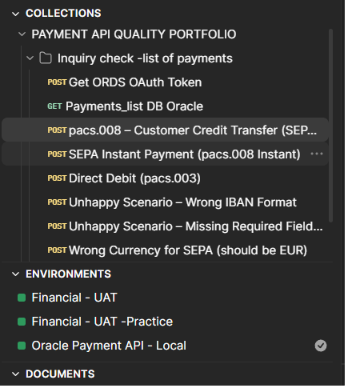
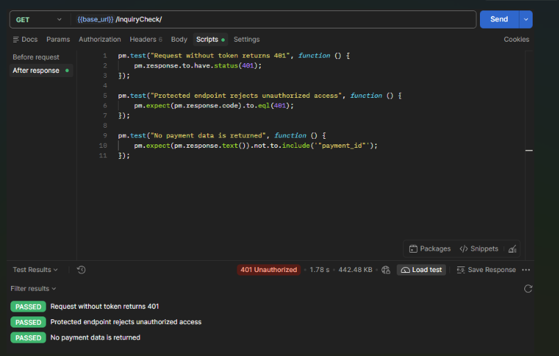
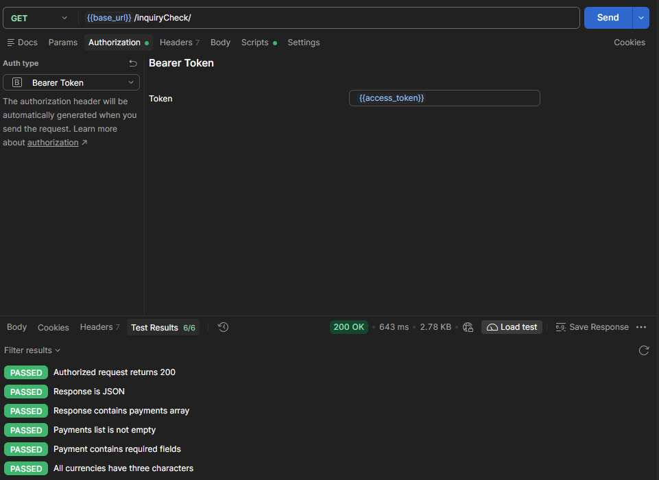
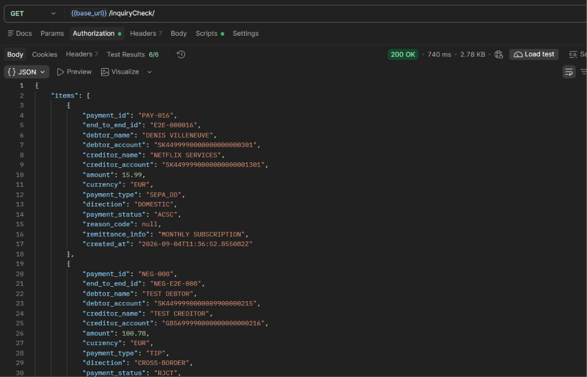

# Banking Payment API Lab

Hands-on API testing portfolio applying banking payment knowledge to REST API quality engineering.

The project uses a synthetic Oracle database exposed through Oracle REST Data Services (ORDS).

## Key Evidence

- REST API testing with Postman
- OAuth 2.0 Client Credentials authentication
- Role-protected ORDS endpoints
- Positive and negative payment scenarios
- JavaScript assertions using `pm.test`
- Automatic access-token extraction and reuse

## All payment, account and party data shown in this repository is synthetic.

## Authentication Flow

POST /oauth/token  
→ Oracle ORDS returns an access token  
→ Postman saves the token  
→ Protected request uses the Bearer token

**Expected results:**

- No token → `401 Unauthorized`
- Invalid token → `401 Unauthorized`
- Valid token → `200 OK`

## Covered Scenarios

- OAuth access-token request
- Protected endpoint without authorization
- Payment-list inquiry
- SEPA Credit Transfer
- SEPA Instant Payment
- Direct Debit
- Invalid IBAN
- Missing required field
- Invalid SEPA currency
- Payment status inquiry
- Payment return

## Postman Files

- `Payment-API-Quality-Portfolio.postman_collection.json`
- `Oracle Payment API - Local.postman_environment.json`

## Project Files

- `Payment-API-Quality-Portfolio.postman_collection.json` – Postman API test collection
- `Oracle-ORDS-Template.postman_environment.json` – reusable Postman environment template
- `openapi 3.0.3.yaml` – OpenAPI contract covering OAuth and payment endpoints

## How to Run

1. Import the collection and environment into Postman.
2. Select the Oracle payment environment.
3. Run `Get ORDS OAuth Token`.
4. Run the protected payment requests.

## Execution Evidence

### Postman Collection Overview

### OAuth Token Generation

OAuth 2.0 Client Credentials request returns `200 OK` and passes all token assertions.

### Unauthorized Request

The protected ORDS endpoint rejects a request without an access token with `401 Unauthorized`.

### Authorized Request

The same endpoint returns `200 OK` with a valid Bearer token and passes six response assertions.

### Synthetic Payment Response

The authorized inquiry returns synthetic payment records from the Oracle database.

## Project Status

- [x] Synthetic Oracle payment database
- [x] Oracle ORDS REST endpoints
- [x] Postman API collection
- [x] OAuth Client Credentials flow
- [x] Role-protected API
- [x] Automatic token handling
- [ ] Newman command-line execution
- [ ] GitHub Actions
